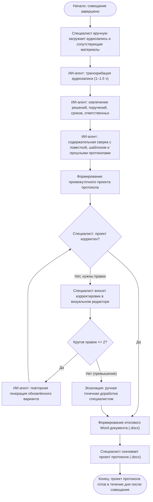

# Агент: ИИ система для протоколирования совещаний Министерства

[](openspec/)
[](https://www.python.org/)
[](https://fastapi.tiangolo.com/)
[](frontend/)
[](#требования-информационной-безопасности)

Программно-аппаратный комплекс автоматизированного составления протоколов аппаратных и оперативных совещаний **Министерства образования Свердловской области** на основе аудиозаписей и сопроводительных материалов.

---

## 📌 О проекте

- **Дипломная тема:** Проект по теме *«Агент: ИИ система для протоколирования совещаний Министерства»*
- **Уровень сложности:** B
- **Тип работ:** Прикладной (практико-ориентированный)
- **Целевой заказчик и пользователи:** Секретариат Министерства образования Свердловской области
- **Ключевой результат:** Готовый проект протокола совещания в формате Microsoft Word (`.docx`) по утверждённому бланку с извлечением решений, поручений, сроков и ответственных лиц, подготовленный не позднее следующего дня после совещания.

---

## 👥 Состав команды и распределение ролей (5 человек)

| Роль | Зона ответственности | Ключевые задачи |
|---|---|---|
| **1. Team Lead / Архитектор системы** | Системная архитектура, OpenSpec, изоляция защищенного контура, координация команды и приёмка | [TL-101 .. TL-401](openspec/changes/001-initial-protocol-agent/tasks.md) |
| **2. AI / ML Engineer (Speech & LLM)** | Офлайн STT (аудио 1.5 ч), доменный словарь Минобразования, квантизация и инференс локальной российской LLM | [ML-101 .. ML-302](openspec/changes/001-initial-protocol-agent/tasks.md) |
| **3. Backend Engineer (NER, RAG, DOCX)** | Бизнес-логика на FastAPI, парсинг материалов, извлечение связок «Кто/Что/Срок», аналитика рисков, сборка DOCX | [BE-101 .. BE-301](openspec/changes/001-initial-protocol-agent/tasks.md) |
| **4. Frontend / Fullstack Developer** | Клиентский интерфейс React/Vite: загрузка файлов, интерактивный редактор проекта протокола, счетчик правок (до 2) | [FE-101 .. FE-301](openspec/changes/001-initial-protocol-agent/tasks.md) |
| **5. QA Engineer / AI Evaluator & TechWriter** | Оценка метрик качества LLM (Recall поручений, отсутствие галлюцинаций), разметка датасетов, инструкция пользователя | [QA-101 .. QA-401](openspec/changes/001-initial-protocol-agent/tasks.md) |

---

## 🔄 Схема бизнес-процесса



---

## 📁 Спецификации OpenSpec

Проект ведётся по методологии **Spec-Driven Development (OpenSpec)**:

- [`openspec/config.yaml`](openspec/config.yaml) — конфигурация проекта и правила спецификаций;
- **Базовые спецификации подсистем (`openspec/specs/`):**
  - [`transcription/spec.md`](openspec/specs/transcription/spec.md) — офлайн STT, обработка аудио 1–1.5 часа;
  - [`protocol-extraction/spec.md`](openspec/specs/protocol-extraction/spec.md) — извлечение поручений, сопоставление со списком участников, анализ пробелов и коллизий;
  - [`document-generation/spec.md`](openspec/specs/document-generation/spec.md) — формирование документа Word по утверждённому ведомственному бланку;
  - [`review-ui/spec.md`](openspec/specs/review-ui/spec.md) — визуальный редактор, лимит кругов правок ($\le 2$);
  - [`security-deployment/spec.md`](openspec/specs/security-deployment/spec.md) — требования автономности и изоляции контура.
- **Активный чейнджсет (`openspec/changes/001-initial-protocol-agent/`):**
  - [`proposal.md`](openspec/changes/001-initial-protocol-agent/proposal.md) — обоснование и границы продукта;
  - [`design.md`](openspec/changes/001-initial-protocol-agent/design.md) — техническая архитектура и структуры данных;
  - [`tasks.md`](openspec/changes/001-initial-protocol-agent/tasks.md) — матрица задач для 5 участников команды с критериями готовности (DoD).

---

## 📅 Дорожная карта и вехи

- **Октябрь – Ноябрь 2026:** Проектирование, подготовка датасета, PoC модулей STT и извлечения сущностей.
- **Декабрь 2026:** 🎯 **Тестовая версия (MVP)** — сквозной пайплайн «Аудио + материалы $\rightarrow$ Черновик $\rightarrow$ Редактор $\rightarrow$ DOCX».
- **Январь 2027:** Оптимизация скорости инференса на локальном ПК, минимизация галлюцинаций, доработка UX.
- **Февраль 2027:** 🎯 **Готовая версия (Release)** — приёмочные испытания, развёртывание на ПК в Министерстве, обучение секретариата.

---

## 🔒 Требования информационной безопасности
1. **Строгая автономность:** работа в изолированном контуре без передачи аудиозаписей, стенограмм и протоколов во внешние публичные облака.
2. **Отечественная технологическая база:** использование российских моделей распознавания речи и LLM-инференса (GigaAM / Faster-Whisper, GigaChat On-Prem / Saiga / Vikhr).
3. **Размещение:** выделенное рабочее место (ПК) сотрудника Министерства образования Свердловской области.

---

## 🚀 Быстрый старт для разработчиков

### Бэкенд (с использованием `uv`)
```bash
# Установка зависимостей и создание виртуального окружения через uv
uv venv
source .venv/bin/activate
uv pip install -e .

# Либо запуск напрямую через uv run:
uv run uvicorn backend.app.main:app --reload --port 8000
```

### Фронтенд
```bash
cd frontend
npm install
npm run dev
```