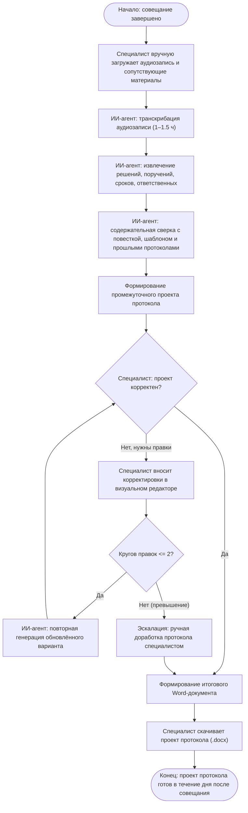

# Technical Design: Архитектура ИИ-агента протоколирования

## 1. System Architecture

Система построена по модульной архитектуре и полностью изолирована для работы на отдельном персональном компьютере (или сервере локальной сети) в защищённом контуре Министерства образования.

```mermaid
flowchart TD
    subgraph UI ["Клиентский уровень (Web Frontend)"]
        UploadView["Загрузка аудио и материалов (повестка, участники, шаблон, архив)"]
        EditorView["Визуальный редактор протокола & Панель аналитики"]
        DownloadView["Экспорт и скачивание .docx"]
    end

    subgraph Backend ["Сервер приложений (FastAPI / Python 3.11)"]
        APIGateway["REST API / Task Orchestrator"]
        Storage["Локальное хранилище сессий & Файловый архив"]
        DocGen["Генератор Word (.docx) на docxtpl / python-docx"]
    end

    subgraph AI_Engine ["ИИ-контур (Автономный локальный стек)"]
        STT["STT Модуль: GigaAM (Русский язык, адаптация)"]
        LLM_Engine["Пайплайн извлечения: Российская LLM (GigaChat On-Prem / Saiga / Vikhr)"]
        EntityResolver["Нормализатор сущностей (NER, даты, ФИО, сопоставление со списком)"]
        CrossChecker["Аналитический модуль: коллизии с архивом и пробелы"]
    end

    UploadView -->|POST /api/sessions/upload| APIGateway
    APIGateway --> Storage
    APIGateway -->|Асинхронная задача| STT
    STT -->|Стенограмма с таймкодами| LLM_Engine
    LLM_Engine --> EntityResolver
    EntityResolver --> CrossChecker
    CrossChecker -->|Структурированный JSON| APIGateway
    APIGateway -->|GET /api/sessions/{id}/draft| EditorView
    EditorView -->|POST /api/sessions/{id}/refine (до 2 раз)| APIGateway
    EditorView -->|POST /api/sessions/{id}/export| DocGen
    DocGen --> DownloadView
```

---

## 2. Process Workflow (Бизнес-процесс протоколирования)

Сценарий работы системы строго воспроизводит утверждённый регламент и блок-схему взаимодействия сотрудника с агентом:



---

## 3. Technology Stack & Component Details

### 3.1. Speech-to-Text (STT)
- **Технология:** `GigaAM-v2` (SberDevices) с локальным запуском на CPU/GPU.
- **Особенности:**
  - Нарезка длинного аудио (chunking с overlap) для стабильной обработки 1.5 часов без утечек памяти;
  - Словарь подсказок (prompt hotwords): включение списка участников совещания, аббревиатур (ЕГЭ, ОГЭ, РИП, ФОП, ИРО) и ключевых терминов повестки для повышения точности распознавания узкоспециальных слов.

### 3.2. Extraction & LLM Pipeline
- **Технологическая база:** Российская LLM (GigaChat On-Prem API / локальный инференс квантованной модели `Vikhr-Nemo-12B` или `Saiga-Llama3-8B` через `vLLM` / `llama.cpp`).
- **Этапы пайплайна:**
  1. *Сегментация стенограммы:* маппинг фрагментов расшифровки на пункты повестки совещания;
  2. *Экстракция резолюций:* извлечение только принятых решений и прямых поручений (отсечение риторических вопросов и промежуточных споров);
  3. *NER & Resolution:*
     - Сопоставление исполнителя по алгоритму нечеткого сравнения (Fuzzy matching + эмбеддинги) с официальным списком участников;
     - Нормализация дат: «к следующей среде», «до 25 числа» $\rightarrow$ фиксированная дата относительно даты проведения совещания;
  4. *Аналитика:*
     - Флаги пробелов: `has_missing_assignee`, `has_missing_due_date`;
     - Проверка противоречий с архивными протоколами (например, повторное назначение противоположного поручения).

### 3.3. Document Generation
- **Библиотека:** `docxtpl` (на базе `python-docx` и Jinja2).
- **Шаблонизация:** В утверждённый ведомственный .docx вставляются плейсхолдеры для номера, даты, состава присутствующих, повестки, протокольной части (СЛУШАЛИ / РЕШИЛИ / ПОРУЧИЛИ с таблицей поручений) и подписей председателя и секретаря.

### 3.4. Backend & API
- **Фреймворк:** FastAPI (Python 3.11+).
- **Эндпоинты:**
  - `POST /api/sessions/create` — создание рабочей сессии совещания;
  - `POST /api/sessions/{id}/upload` — загрузка аудио и сопутствующих файлов;
  - `GET /api/sessions/{id}/status` — опрос статуса обработки (STT $\rightarrow$ Extraction $\rightarrow$ Analytics);
  - `GET /api/sessions/{id}/draft` — получение структурированного JSON проекта протокола и аналитики;
  - `POST /api/sessions/{id}/refine` — отправка правок пользователя на повторную генерацию (с проверкой счетчика кругов);
  - `POST /api/sessions/{id}/export` — формирование и скачивание итогового `.docx`.

### 3.5. Frontend UI
- **Стек:** React 18, Vite, Tailwind CSS, Lucide Icons.
- **Ключевые экраны:**
  1. *Мастер создания сессии:* мульти-загрузка файлов с индикацией готовности;
  2. *Рабочий стол секретаря:* сплит-экран (слева — стенограмма и аналитика пробелов/рисков, справа — интерактивный проект протокола с возможностью правки формулировок, ответственных и сроков);
  3. *Индикатор кругов правок:* визуальный счетчик (Круг 1 из 2, Круг 2 из 2) с переходом в ручной режим при превышении.

---

## 4. Data Models (JSON Schema Draft Protocol)

```json
{
  "session_id": "uuid-v4",
  "metadata": {
    "meeting_title": "Аппаратное совещание Министерства образования",
    "meeting_date": "20.10.2026",
    "chairperson": "Министр образования Свердловской области",
    "secretary": "Специалист секретариата",
    "attendees": ["Иванов И.И.", "Петров П.П.", "Сидорова С.С."]
  },
  "agenda_items": [
    {
      "item_number": 1,
      "topic": "О готовности к проведению государственной итоговой аттестации",
      "reporter": "Петров П.П.",
      "decisions": ["Принять к сведению доклад..."],
      "action_items": [
        {
          "id": "act-1",
          "task": "Обеспечить проверку готовности пунктов проведения экзаменов",
          "assignee": "Петров П.П.",
          "assignee_role": "Начальник отдела контроля качества образования",
          "due_date": "15.11.2026",
          "status": "valid",
          "quote": "Петрову обеспечить проверку готовности ППЭ до 15 ноября"
        }
      ]
    }
  ],
  "analytics": {
    "gaps": [
      {
        "type": "MISSING_DUE_DATE",
        "description": "Поручение по обновлению методических рекомендаций не содержит срока исполнения",
        "context_quote": "Также надо обновить методички коллегам"
      }
    ],
    "contradictions": [],
    "risks": []
  },
  "revision_cycle": {
    "current_cycle": 0,
    "max_cycles": 2,
    "is_escalated_to_manual": false
  }
}
```
