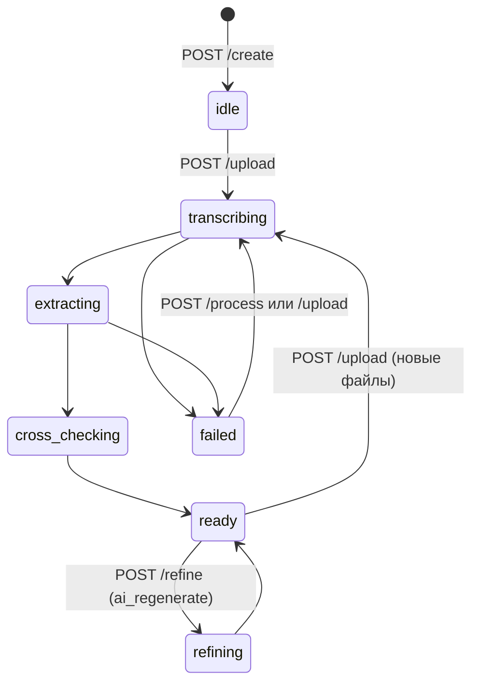

# Baseline Specification: REST API Contract

## Overview
Единый API-контракт между клиентской частью (Web Frontend) и серверной частью (FastAPI Backend) программного комплекса «Агент: ИИ система для протоколирования совещаний Министерства образования».

- Машиночитаемый контракт: [`docs/api/openapi.json`](../../../docs/api/openapi.json) (генерируется `uv run python scripts/export_openapi.py`; тест `tests/test_openapi_contract.py` падает, если файл не совпадает с кодом).
- Интерактивно: `/docs` (Swagger UI), `/api/openapi.json`.
- Руководство по интеграции для фронтенда: [`docs/api/frontend_integration.md`](../../../docs/api/frontend_integration.md).

Общие правила:
- все даты в данных протокола — строки `ДД.ММ.ГГГГ`; служебные метки времени (`created_at`, `updated_at`, `generated_at`) — ISO 8601 UTC;
- ошибки возвращаются как `{"detail": "<человекочитаемый текст на русском>"}` (для 422 — стандартный массив ошибок валидации FastAPI);
- длительные операции (STT + LLM, ИИ-правка) выполняются в фоне; клиент опрашивает `GET /status` (рекомендуемый интервал 2–3 с).

---

## 1. Сводная таблица эндпоинтов

| Метод | Путь | Описание | Коды |
|---|---|---|---|
| `GET` | `/api/health` | Проверка сервиса | `200` |
| `GET` | `/api/sessions` | Список сессий (новые первыми) | `200` |
| `POST` | `/api/sessions/create` | Создание сессии | `201`, `422` |
| `GET` | `/api/sessions/{id}` | Полное состояние сессии (восстановление экрана) | `200`, `404` |
| `DELETE` | `/api/sessions/{id}` | Удаление сессии и всех файлов | `204`, `404`, `409` |
| `POST` | `/api/sessions/{id}/upload` | Загрузка материалов и **запуск обработки** | `200`, `400`, `404`, `409`, `413` |
| `POST` | `/api/sessions/{id}/process` | Повтор обработки по загруженным файлам | `200`, `400`, `404`, `409` |
| `GET` | `/api/sessions/{id}/status` | Прогресс обработки | `200`, `404` |
| `GET` | `/api/sessions/{id}/draft` | Проект протокола + аналитика | `200`, `404` |
| `GET` | `/api/sessions/{id}/transcript` | Стенограмма с таймкодами | `200`, `404` |
| `POST` | `/api/sessions/{id}/refine` | Ручное сохранение / ИИ-правка (≤ 2 кругов) | `200`, `400`, `404`, `409` |
| `POST` | `/api/sessions/{id}/export` | Формирование `.docx` | `200`, `404`, `409`, `500` |
| `GET` | `/api/sessions/{id}/download` | Скачивание `.docx` | `200`, `404` |

`409 Conflict` — сессия сейчас обрабатывается (`transcribing`, `extracting`, `cross_checking`, `refining`) или проект ещё не сформирован.

---

## 2. Жизненный цикл и статусы



| `status` | Значение |
|---|---|
| `idle` | сессия создана, файлов нет |
| `transcribing` | разбор материалов и распознавание речи (STT) |
| `extracting` | извлечение решений и поручений локальной LLM (прогресс по фрагментам) |
| `cross_checking` | сверка с участниками и архивом, аналитика |
| `ready` | проект готов к вычитке |
| `refining` | выполняется ИИ-правка |
| `failed` | ошибка; текст в `error_message`, повтор — `POST /process` |

`uploading` зарезервирован и сервером не выставляется.

---

## 3. Контракты

### 3.1. `POST /api/sessions/create`
Тело (JSON, все поля необязательны):
```json
{
  "meeting_title": "Аппаратное совещание",
  "meeting_date": "20.10.2026",
  "protocol_number": "12",
  "chairperson": null,
  "secretary": null
}
```
`meeting_date` по умолчанию — текущая дата; неверный формат → `422`. Председатель и секретарь, если не заданы, берутся из списка участников (строки «Председатель: …», «Секретарь: …»).

Ответ `201`: `{"session_id": "uuid", "status": "idle", "created_at": "..."}`

### 3.2. `POST /api/sessions/{id}/upload` (multipart/form-data)
| Поле | Обяз. | Форматы |
|---|---|---|
| `audio_file` | одно из двух | `.wav .mp3 .m4a .ogg .flac .aac .wma .mp4 .mkv .webm .mov .avi` |
| `transcript_file` | одно из двух | готовая стенограмма: `.json` (формат `MeetingTranscription`), `.txt .docx .pdf .md` (строки могут начинаться с `[чч:мм:сс]`) |
| `agenda_file` | нет | `.txt .docx .pdf .md` |
| `attendees_file` | нет | `.txt .docx .pdf .md` |
| `template_file` | нет | `.docx` с полями docxtpl ([разметка](../../../docs/backend/docx_template.md)) |
| `archive_files` | нет, несколько | `.txt .docx .pdf .md` |

Каждая загрузка — **полный комплект**: предыдущие файлы, стенограмма и проект сессии заменяются. Ответ — `SessionStatusResponse` (обычно `transcribing`). Ошибки: `400` (нет аудио/стенограммы, неверный формат), `413` (больше `MAX_UPLOAD_MB`), `409`.

### 3.3. `GET /api/sessions/{id}/status`
```json
{
  "session_id": "…",
  "status": "extracting",
  "progress_percent": 67,
  "current_step_description": "Извлечение решений и поручений: фрагмент 3 из 6…",
  "error_message": null,
  "updated_at": "2026-10-20T09:05:00Z"
}
```
После ИИ-правки в `current_step_description` — итог: какие изменения применены и какие отклонены.

### 3.4. `GET /api/sessions/{id}` — `SessionDetailsResponse`
Статус + `has_draft`, `has_transcript`, имена загруженных файлов (`files`), последний экспорт (`export`), замечания разбора материалов (`input_warnings`). Используется для восстановления экрана после перезагрузки страницы.

### 3.5. `GET /api/sessions/{id}/draft` — `ProtocolDraft`
```json
{
  "session_id": "…",
  "metadata": {
    "meeting_title": "Аппаратное совещание",
    "meeting_date": "20.10.2026",
    "protocol_number": "12",
    "chairperson": "Иванов И.И.",
    "secretary": "Кузнецова А.В.",
    "attendees": [
      {"full_name": "Петров Петр Петрович", "short_name": "Петров П.П.", "position": "начальник отдела"}
    ]
  },
  "agenda_items": [
    {
      "item_number": 1,
      "topic": "О готовности к государственной итоговой аттестации",
      "reporter": "Петров П.П.",
      "decisions": [
        {"id": "dec-1a2b3c4d", "text": "Принять информацию к сведению",
         "quote": "Решили информацию принять к сведению.",
         "source_start": 30.0, "source_end": 39.0, "origin": "ai"}
      ],
      "action_items": [
        {
          "id": "act-5e6f7a8b",
          "task": "Обеспечить готовность всех пунктов проведения экзаменов",
          "assignee": "Петров П.П.",
          "assignee_role": "начальник отдела",
          "assignee_raw": "Петрову",
          "due_date": "15.11.2026",
          "due_date_raw": "до пятнадцатого ноября",
          "is_recurring": false,
          "status": "valid",
          "quote": "Петрову обеспечить готовность … до пятнадцатого ноября.",
          "source_start": 40.0,
          "source_end": 49.0,
          "origin": "ai"
        }
      ]
    }
  ],
  "analytics": {
    "gaps": [
      {"type": "MISSING_DUE_DATE", "severity": "high",
       "description": "п. 1.3: поручение «Обновить инструкции…» не содержит срока исполнения.",
       "agenda_item_number": 1, "action_item_id": "act-…",
       "context_quote": "Также надо обновить инструкции для наблюдателей.", "source_start": 50.0}
    ],
    "contradictions": [
      {"id": "con-…", "scope": "archive",
       "description": "п. 2.1: аналогичное поручение ранее было дано …",
       "action_item_ids": ["act-…"], "quotes": ["…"], "archive_reference": "Протокол № 11 от 13.10.2026, п. 1"}
    ],
    "risks": [
      {"id": "risk-…", "type": "REPEATED_ASSIGNMENT", "severity": "medium",
       "description": "п. 2.1: поручение повторяет пункт из Протокол № 11 … — вероятно, оно не исполнено в срок.",
       "action_item_ids": ["act-…"], "archive_reference": "Протокол № 11 от 13.10.2026, п. 1"}
    ]
  },
  "revision_cycle": {"current_cycle": 0, "max_cycles": 2, "is_escalated_to_manual": false}
}
```
Правила полей:
- `status` поручения **вычисляется сервером**: `valid` | `missing_date` | `missing_assignee` | `missing_assignee_and_date` (периодическое `is_recurring=true` срок не требует);
- `assignee`/`due_date` = `null`, если не прозвучали — сервер их **не выдумывает**;
- `quote`/`source_start` позволяют подсветить фрагмент стенограммы; `origin: "manual"` — пункт добавлен секретарём (нет цитаты);
- нумерация пунктов в документе: `<item_number>.<n>`, где сначала идут решения, затем поручения;
- `gaps[].type`: `MISSING_DUE_DATE`, `VAGUE_DUE_DATE`, `MISSING_ASSIGNEE`, `AMBIGUOUS_ASSIGNEE`, `UNMATCHED_ASSIGNEE`, `NO_DECISION_FOR_AGENDA_ITEM`, `REJECTED_UNGROUNDED`, `UNPROCESSED_FRAGMENT`, `MISSING_INPUT`;
- `risks[].type`: `DEADLINE_IN_PAST`, `TIGHT_DEADLINE`, `WEEKEND_DEADLINE`, `ASSIGNEE_OVERLOAD`, `REPEATED_ASSIGNMENT`, `DUPLICATE_ITEM`;
- `severity`: `high` | `medium` | `low`.

### 3.6. `GET /api/sessions/{id}/transcript` — `MeetingTranscription`
`{"model": "e2e_rnnt", "source": "meeting.mp3", "text": "…", "segments": [{"start": 0.0, "end": 9.0, "text": "…"}]}`. Для импортированной текстовой стенограммы `model = "text-import"`.

### 3.7. `POST /api/sessions/{id}/refine`
```json
{
  "action": "ai_regenerate",
  "user_feedback": "По инструкциям для наблюдателей ответственная Сидорова, срок до 25 ноября",
  "updated_metadata": null,
  "updated_agenda_items": null
}
```
- `updated_metadata` / `updated_agenda_items` (необязательно) — правки секретаря из редактора; применяются **до** ИИ-правки. Для ручной правки отправляйте полный массив `agenda_items`;
- `manual_save` — синхронно сохраняет правки и пересчитывает аналитику; лимит не расходуется; доступно всегда (в т.ч. после эскалации);
- `ai_regenerate` — требует непустой `user_feedback` (иначе `400`) и сформированный проект (иначе `409`). Счётчик увеличивается сразу, ответ приходит со `status: "refining"`; клиент опрашивает `/status` до `ready` и перечитывает `/draft`. Если ИИ-правка не удалась, круг **возвращается**, а причина появляется в `error_message`;
- третья попытка → `400` `{"detail": "Превышен лимит автоматических кругов правок (максимум 2). Переключено в режим ручной доработки."}`; правки из запроса при этом сохраняются, `is_escalated_to_manual = true`.

Ответ `RefineDraftResponse`: `{session_id, status, updated_draft, revision_cycle, message}`.

### 3.8. `POST /api/sessions/{id}/export` и `GET /api/sessions/{id}/download`
```json
{
  "session_id": "…",
  "file_name": "Протокол_совещания_20.10.2026_9b1deb4d.docx",
  "download_url": "/api/sessions/9b1deb4d-…/download",
  "warnings": [],
  "generated_at": "2026-10-20T10:15:00Z"
}
```
`warnings` не пуст, если загруженный шаблон без полей или с ошибкой — тогда использован бланк по умолчанию. `GET /download` отдаёт файл с `Content-Disposition: attachment; filename*=utf-8''…`. Любое изменение проекта сбрасывает экспорт — экспорт нужно выполнить повторно.

---

## 4. Requirements

### Requirement: API-01 Contract Stability
Изменение схем или эндпоинтов MUST сопровождаться обновлением `docs/api/openapi.json` и этого документа.

#### Scenario: Изменение схемы без обновления контракта
- **GIVEN** разработчик изменил Pydantic-схему ответа
- **WHEN** запускается `uv run pytest`
- **THEN** тест `test_committed_openapi_matches_code` падает с указанием команды обновления.

### Requirement: API-02 Non-blocking Long Operations
Обработка аудио и ИИ-правка MUST выполняться в фоне; HTTP-запрос MUST возвращаться без ожидания STT/LLM.

#### Scenario: Перезапуск сервера во время обработки
- **GIVEN** сессия в статусе `transcribing` или `refining`
- **WHEN** сервер перезапускается
- **THEN** сессия переводится в `failed` (повтор через `/process`) либо в `ready` с возвратом круга правок.
